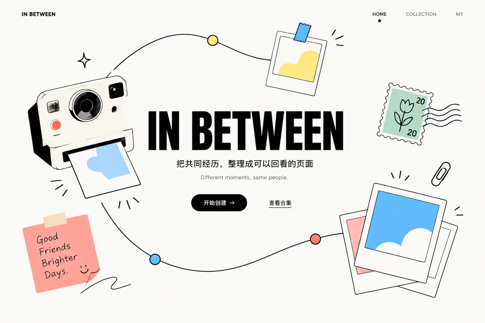
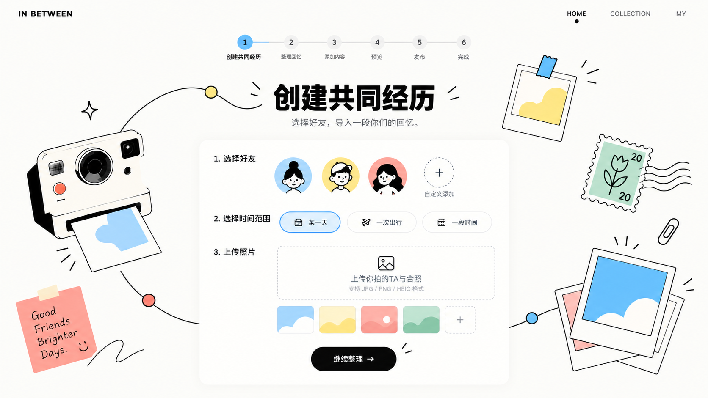
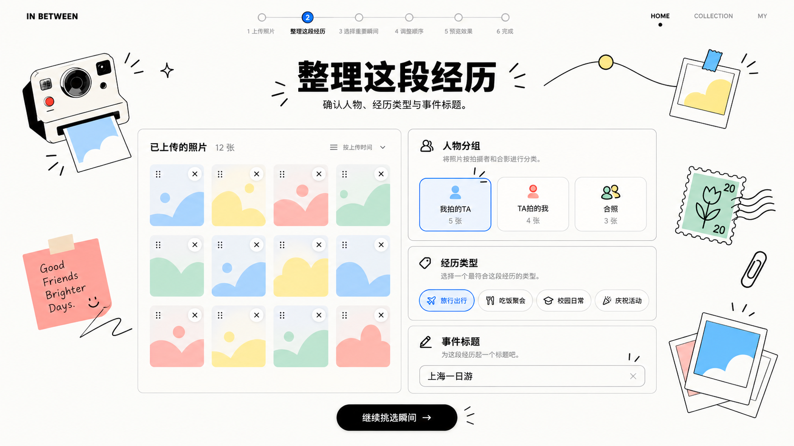
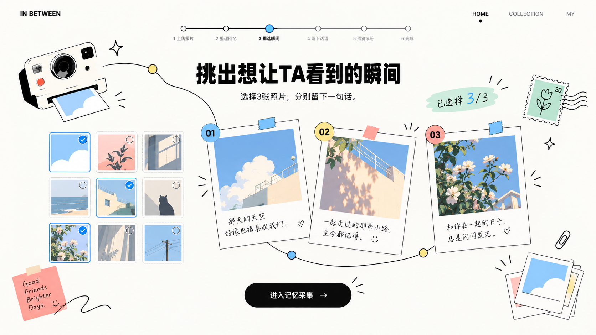
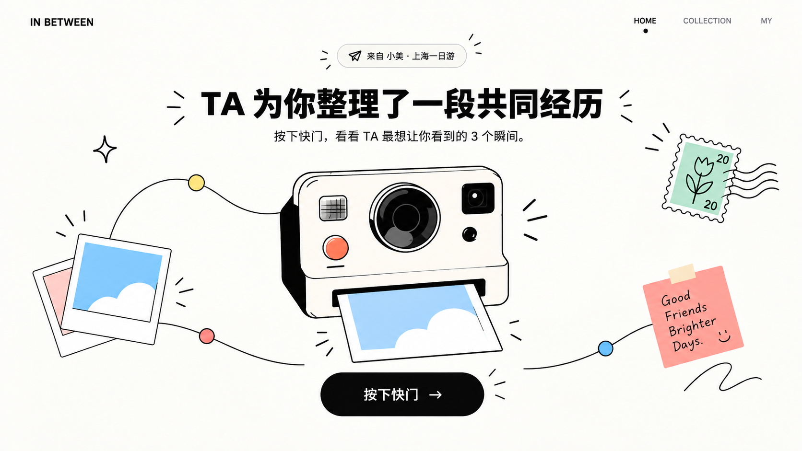
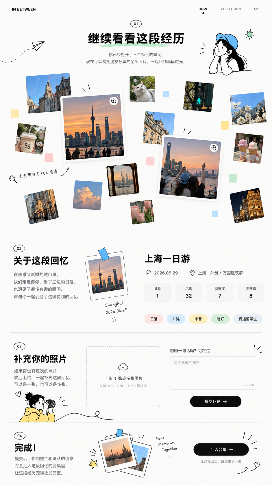
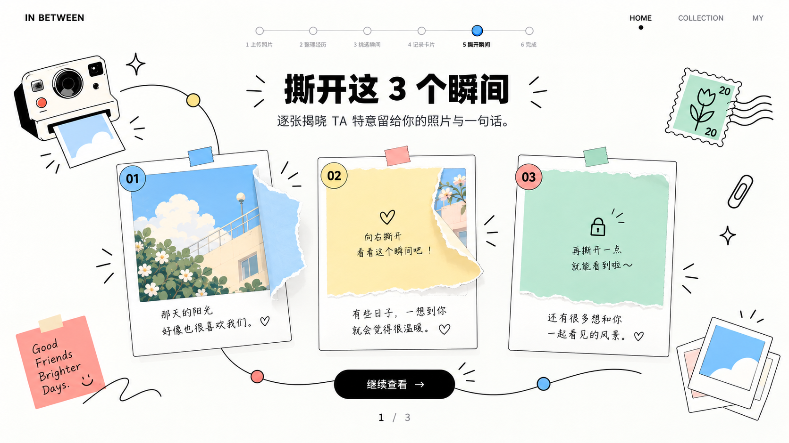
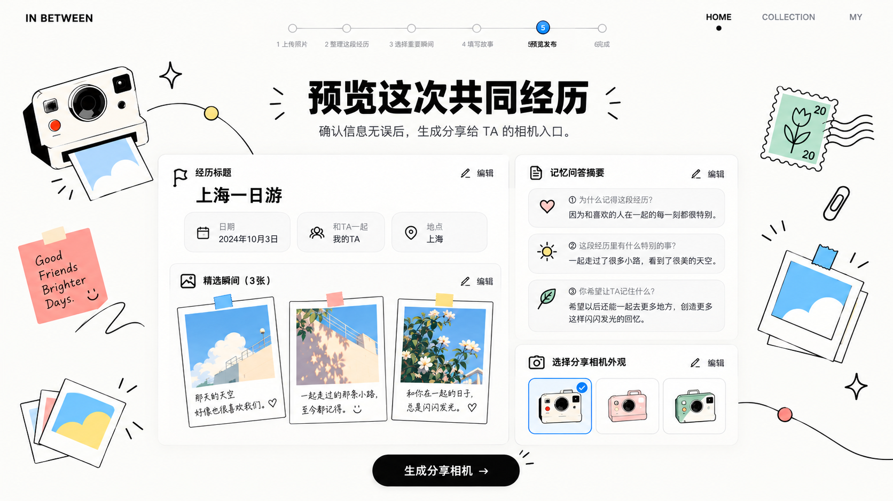
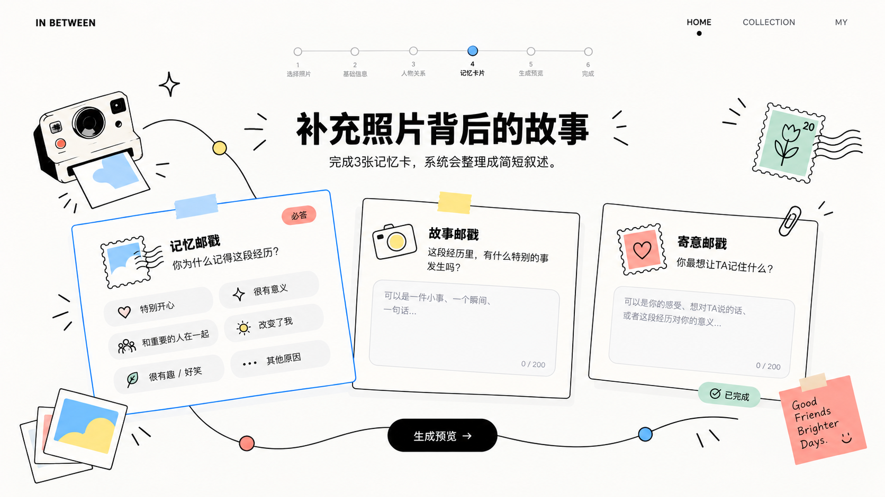

# -
学习交互网页
# Photo Gallery Creative Website
> Turn shared memories into a revisit-able webpage
> 把共同经历，整理成可回看的网页

## 📌 项目简介
这是一个照片创意交互网站设计项目，聚焦共同回忆的收集、整理与浏览，包含照片上传、选择、反馈查看、撕拉片创意展示等交互界面。
本仓库存放项目说明文档与UI界面设计稿。

## 🖼️ 页面预览

## 📁 仓库文件说明
- `信息设计与表达.docx` / `照片整理Lucky.docx`：项目方案、文字资料
- 所有 `.png` 文件：网站界面、交互流程效果图

## 🛠️ 设计工具
Figma 交互 & UI设计

## ✨ 设计概念
以照片为载体，收集多人的共同经历，做成可以回看、留存回忆的线上影集。
